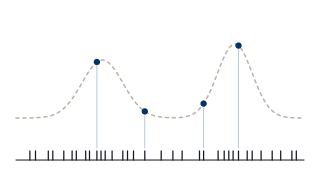
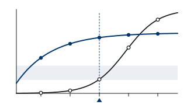
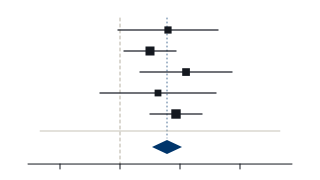
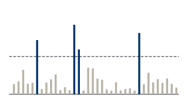

::: {.masthead}
::: {.masthead-text}
[Biostatistics · Yale School of Public Health]{.label}

# Cheng-Han Yang

::: {.masthead-dek}
Statistical methods for *electronic health records* and *clinical trials*.
:::

::: {.masthead-role}
Associate Research Scientist (Research Faculty), Department of Biostatistics · Yale University
:::

::: {.masthead-links}
- [Email](mailto:cheng-han.yang@yale.edu)
- [CV (PDF)](files/ChengHan_Yang_CV.pdf)
- [Google Scholar](https://scholar.google.com/citations?user=SOJu3GAAAAAJ&hl=zh-TW)
- [GitHub](https://github.com/cyang728)
- [ORCID](https://orcid.org/0000-0002-4161-3140)
:::
:::

::: {.masthead-portrait}
{fig-alt="Portrait of Cheng-Han Yang" width="640" height="800"}
:::
:::

```{=html}
<svg class="rug" viewBox="0 0 1200 34" preserveAspectRatio="none" aria-hidden="true">
<line class="axis" x1="0" y1="33" x2="1200" y2="33"/>
<g class="visit">
<line x1="18" y1="33" x2="18" y2="21"/><line x1="61" y1="33" x2="61" y2="21"/><line x1="140" y1="33" x2="140" y2="21"/>
<line x1="175" y1="33" x2="175" y2="21"/><line x1="260" y1="33" x2="260" y2="21"/><line x1="330" y1="33" x2="330" y2="21"/>
<line x1="410" y1="33" x2="410" y2="21"/><line x1="497" y1="33" x2="497" y2="21"/><line x1="520" y1="33" x2="520" y2="21"/>
<line x1="610" y1="33" x2="610" y2="21"/><line x1="690" y1="33" x2="690" y2="21"/><line x1="742" y1="33" x2="742" y2="21"/>
<line x1="830" y1="33" x2="830" y2="21"/><line x1="905" y1="33" x2="905" y2="21"/><line x1="990" y1="33" x2="990" y2="21"/>
<line x1="1090" y1="33" x2="1090" y2="21"/>
</g>
<g class="obs">
<line x1="52" y1="33" x2="52" y2="4"/><line x1="168" y1="33" x2="168" y2="4"/><line x1="182" y1="33" x2="182" y2="4"/>
<line x1="344" y1="33" x2="344" y2="4"/><line x1="512" y1="33" x2="512" y2="4"/><line x1="528" y1="33" x2="528" y2="4"/>
<line x1="751" y1="33" x2="751" y2="4"/><line x1="1004" y1="33" x2="1004" y2="4"/><line x1="1013" y1="33" x2="1013" y2="4"/>
<line x1="1170" y1="33" x2="1170" y2="4"/>
</g>
</svg>
<p class="rug-caption">One patient’s record, read as data: every mark is a clinic visit; the tall ones are visits where a biomarker was measured.</p>
```

::: {.split}
::: {.split-side}
## Research focus

[All research](research.qmd){.more}
:::

::: {.threads}
::: {.thread}
{.illus fig-alt="Irregular clinic visits along a patient's timeline, with biomarker measurements clustered where latent health worsens"}

[01]{.thread-num}

### [Methods for Electronic Health Records](research.qmd#methods-for-electronic-health-records)

::: {.thread-text}
Joint models that correct the biases from informative visiting and observation in large-scale EHR data.
:::
:::

::: {.thread}
{.illus fig-alt="A rising toxicity curve and a plateauing efficacy curve across five dose levels, with the target toxicity interval shaded and the selected dose marked"}

[02]{.thread-num}

### [Adaptive Dose-Finding Design](research.qmd#adaptive-dose-finding-design)

::: {.thread-text}
Seamless phase I–II designs that use biological mediators and survival endpoints to optimize dose.
:::
:::

::: {.thread}
{.illus fig-alt="A forest plot of five study estimates with confidence intervals and a narrower pooled estimate shown as a diamond"}

[03]{.thread-num}

### [Clinical Trial Methodology](research.qmd#clinical-trial-methodology)

::: {.thread-text}
Meta-analytic and covariate-adjusted methods that sharpen inference across early-phase trials.
:::
:::

::: {.thread}
{.illus fig-alt="Bars showing screening statistics for many candidate covariates, with a threshold line and the four covariates above it highlighted"}

[04]{.thread-num}

### [Optimal Treatment Regime](research.qmd#optimal-treatment-regime)

::: {.thread-text}
Model-free variable screening for individualized treatment decisions in high-dimensional survival data.
:::
:::
:::
:::

::: {.split .about-news}
::: {.split-side}
## About

::: {.facts}
[At a glance]{.facts-h}

[Position]{.k} [Associate Research Scientist (Research Faculty)<br>Yale School of Public Health]{.v}

[Ph.D.]{.k} [Biostatistics & Data Science, 2025<br>UTHealth Houston (MD Anderson)]{.v}

[Based in]{.k} [New Haven, CT]{.v}
:::
:::

::: {.about}
I am an Associate Research Scientist (Research Faculty) in the [Department of Biostatistics](https://ysph.yale.edu/public-health-research-and-practice/department-research/biostatistics/) at the [Yale School of Public Health](https://ysph.yale.edu/), working with [Dr. Bhramar Mukherjee](https://ysph.yale.edu/profile/bhramar-mukherjee/). My work bridges EHR-derived real-world evidence and early-phase drug development, with methodological contributions in causal inference, survival and longitudinal data analysis, covariate adjustment, and Bayesian dose optimization.

My first-author methodology has appeared in *Biometrika*, the *Annals of Applied Statistics*, and *Statistics in Medicine*, with related work revised and resubmitted at the *Journal of the American Statistical Association* and *Biometrics*. My current EHR research spans *All of Us*, the UK Biobank, Yale New Haven Health, the Michigan Genomics Initiative, and Epic Cosmos.
:::

::: {.news}
## News

- [Aug 2026]{.date} [Oral presentation at the Joint Statistical Meetings, Boston.]{.what}
- [Mar 2026]{.date} [Invited seminar at Penn Medicine, University of Pennsylvania.]{.what}
- [Jan 2026]{.date} [Invited talk at the Yale Public Health Data Science & Data Equity Seminar.]{.what}
- [Dec 2025]{.date} [DEMO published in *Annals of Applied Statistics*.]{.what}
:::
:::

::: {.split .band}
::: {.split-side}
## Selected publications

First-author methodology and lead collaborations. The full list is on the [Publications](publications.qmd) page.

[\* Equal contribution.]{.pub-note}

[All publications & talks](publications.qmd){.more}
:::

::: {#selected-pubs}
:::
:::

::: {.split}
::: {.split-side}
## Latest writing

[All posts](blog.qmd){.more}
:::

::: {#latest-writing}
:::
:::
